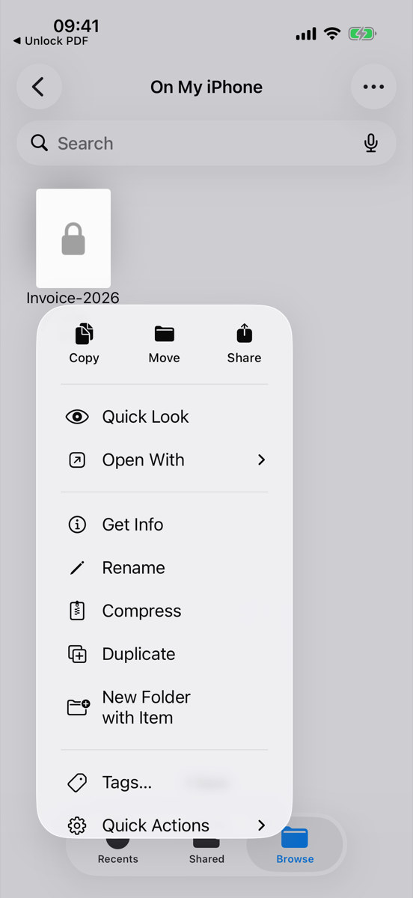
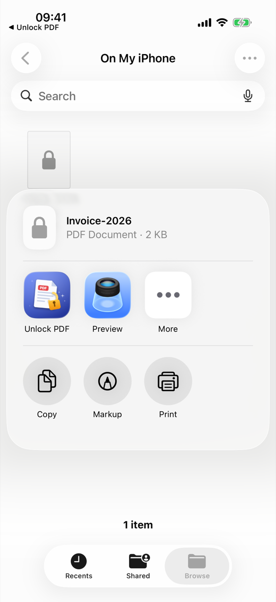
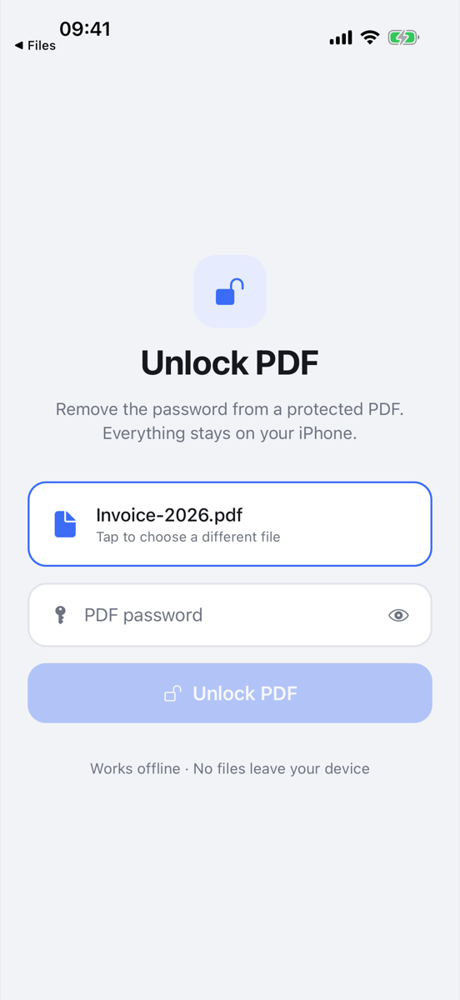
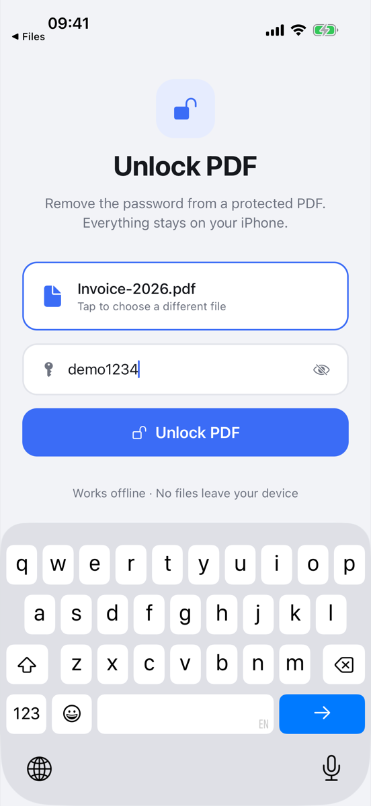
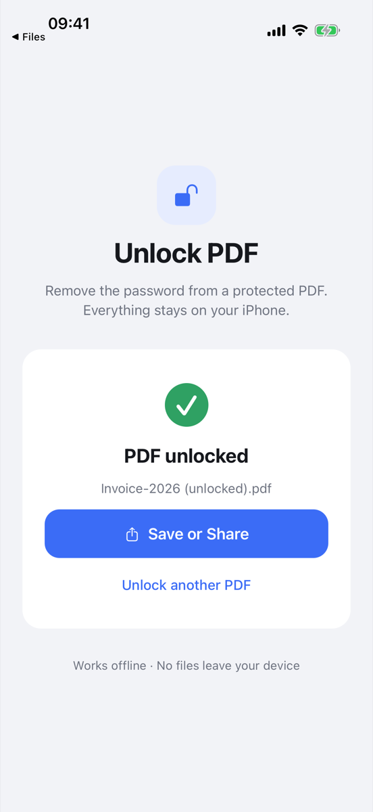

# Importing a PDF from the Share Sheet

Any app that can share a PDF (Mail, Files, Safari, Messages, …) can hand it
straight to Unlock PDF. There's no need to save it to Files and pick it again.

| 1. Share the PDF | 2. Pick **Unlock PDF** | 3. App opens with it selected | 4. Enter the password | 5. Done |
| :---: | :---: | :---: | :---: | :---: |
|  |  |  |  |  |

Screenshots: iPhone 17 simulator, iOS 26.5, Release build, sharing from Files.

## How it works

1. `expo-sharing` adds a share extension (`expo-sharing-extension` target)
   whose activation rule (`app.json`) only matches a single PDF, so it doesn't
   appear for images, links or text.
   `plugins/with-share-extension-name.js` changes its display name from the
   target name to "Unlock PDF".
2. When tapped, the extension copies the PDF into the
   `group.com.dlhyl.unlockpdf` App Group, records it in the group's
   `UserDefaults` and opens `unlockpdf://expo-sharing`.
3. `src/app/+native-intent.ts` routes that link to the unlock screen, which
   reads the shared PDF (`Sharing.getSharedPayloads()`) on launch and whenever
   the app returns to the foreground. It then clears the payload and preselects
   the file.

## Testing

```sh
npx expo run:ios --configuration Release   # dev client intercepts the hand-off
./scripts/seed-simulator-pdf.sh             # Invoice-2026.pdf, password demo1234
maestro test .maestro/share-sheet.yaml      # also regenerates the screenshots
```

Verified manually as well: a second share while the app is already open on
the "PDF unlocked" screen replaces the file and resets the form.
